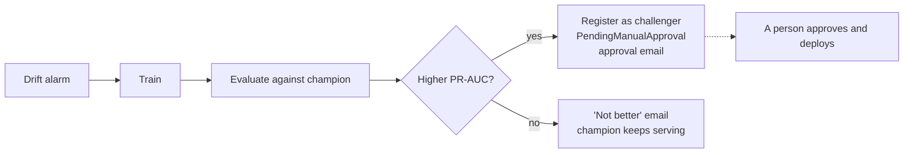
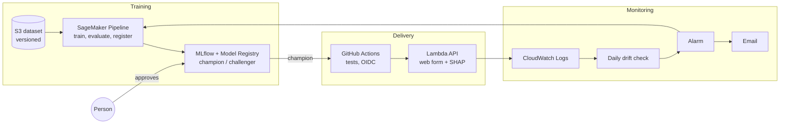

# FairLend: the story of a credit risk model, from notebook to self-monitoring service

This document tells how this project grew from a Jupyter notebook into a small
but complete MLOps system on AWS. It follows the order in which the work
actually happened, including the bugs we found and the things that went wrong
along the way. For setup commands, see `README.md`.

---

## 1. The starting point

The project began as a classic data science notebook, `Credit_Risk.ipynb`. It
used a public dataset of 32,581 consumer loans. Each row describes an applicant
(age, income, home ownership, years employed), the loan (purpose, grade, amount,
interest rate) and their credit file (any previous default, length of credit
history). The target column, `loan_status`, says whether the borrower defaulted.
About 22% did.

The notebook cleaned the data, compared logistic regression with XGBoost, tuned
XGBoost with a 150-trial random search, calibrated its probabilities, picked a
decision threshold and drew SHAP plots to explain the model. It then saved two
files: `credit_risk_model.pkl` and `best_threshold.pkl`.

A FastAPI app (`main.py`) loaded those files and served a web form, the
"Credit Ledger". A loan officer could type in an application and see:

- the probability of default,
- a risk band (Low, Medium, High),
- a SHAP breakdown of which factors pushed the risk up or down.

It ran on Render's free tier. It looked finished. It wasn't.

---

## 2. The review: what was really wrong

Before adding any MLOps, we reviewed the project and ran checks against the
saved model. Four problems changed the predictions the app was making.

**The F1 formula had a typo.** The threshold search computed
`2 * (precision - recall) / (precision + recall)` instead of
`2 * precision * recall / (precision + recall)`. The wrong formula rewards high
precision and low recall, so the saved threshold was 0.695, far too strict.

**The threshold belonged to a different model.** It was chosen with the untuned,
uncalibrated XGBoost, but applied to the tuned, calibrated one. Their
probabilities are on different scales, so 0.695 meant nothing for the deployed
model. It was also chosen on the test set, which makes the test results look
better than they are.

**The SHAP chart explained a different model.** Calibration with 5-fold cross
validation produces 5 models and averages them. The app explained only the
first one. For one sample applicant, that fold model said 2.7% while the
deployed average said 2.1%.

**The explanation didn't add up.** The app hid one-hot columns whose value was
0, but those columns still carry SHAP value (being "not Grade D" also moves the
score). The factors on screen never summed to the model's output.

There were also smaller issues. The API accepted anything: a negative income,
an age of 500, or `loan_grade: "Z"`, which quietly scored as a 2.7% risk.
Library versions weren't pinned, so the pickle might not load the same way on
another machine. And the data cleaning silently dropped every row with a
missing employment length.

---

## 3. Phase 1: making the model trustworthy

The fix started by moving training out of the notebook into a Python package,
`credit_risk/`, that any machine can run with one command:

```
python -m credit_risk.train
```

The new training script is built so the test set can't leak into decisions:

1. A stratified 20% test set (6,482 rows) is set aside and used only for the
   final report.
2. Hyperparameters are tuned with 5-fold cross validation on the training set.
3. Out-of-fold predictions on the training set are used to fit Platt (sigmoid)
   calibration and to pick the F1-best threshold, now with the correct formula.
4. One XGBoost model is refit on the whole training set. That same model makes
   every prediction and produces every explanation.

For SHAP, each original input is now one factor: all the "Loan Grade" one-hot
columns are summed into a single "Loan Grade" row. Because calibration is a
monotonic function of the model's log-odds, the factors add up exactly to the
score. A test checks this on every run.

That test caught a surprise. `shap.TreeExplainer` reported a base value that was
0.014 off for XGBoost 3.x, so the factors still didn't add up. Switching to
XGBoost's built-in SHAP calculation fixed it, and it removed the `shap` package
from the serving image as a bonus.

The API was also hardened. Unknown categories, out-of-range numbers, and an
employment or credit history longer than the applicant's age now get a clear
HTTP 422 error. The loan-to-income ratio is computed on the server instead of
trusted from the browser.

The retrained model, on the held-out test set:

| | New XGBoost | Logistic regression baseline |
|---|---|---|
| ROC-AUC | 0.953 | 0.872 |
| PR-AUC | 0.912 | 0.708 |
| Precision / recall | 0.976 / 0.738 | 0.539 / 0.782 |

Calibration lowered the Brier score from 0.066 to 0.050, so the probabilities
became more honest. The corrected threshold was 0.578 instead of 0.695.

The model is now saved in version-stable formats (XGBoost's own JSON format plus
a small scikit-learn preprocessor), next to a `model_meta.json` that records the
data hash, parameters, metrics and library versions.

---

## 4. Phase 2: training in the cloud with a memory

With a reliable training script, the next step was to run it on AWS in the
Mumbai region (ap-south-1) and keep a record of every run.

All AWS resources are written as code with AWS CDK (`infra/app.py`), so the
whole setup can be recreated or deleted with one command. The first stack,
`CreditRiskMlops`, created:

- a versioned S3 bucket for the dataset, model files and experiment artifacts,
- an ECR repository for the training image,
- SageMaker's serverless MLflow, to track experiments and register models,
- IAM roles that can only touch these resources.

`scripts/launch_training.py` uploads the dataset (only if it changed), builds
`Dockerfile.train`, tags the image with the git commit, and runs training on
SageMaker. Each run logs its parameters, 30 metrics, and calibration,
precision-recall and SHAP importance plots to MLflow. It also records which git
commit, image and S3 data version produced the model.

Three things went wrong first, and each taught something:

- **New AWS accounts can't run SageMaker Training jobs.** The quota for every
  training instance type starts at 0. The same container runs fine as a
  SageMaker Processing job on `ml.t3.large`, which the quota allows, so that is
  what the project uses.
- **The first run failed with AccessDenied.** The MLflow client uploads plots
  straight to S3 with the job's own credentials, and the job role couldn't
  write there. One more IAM permission fixed it.
- **Docker couldn't log in to ECR on Windows.** The ECR token is too long for
  the Windows credential store. The script now uses a temporary Docker config
  for the login.

The first cloud run took about 7 minutes and became **`credit-risk-xgboost`
version 1**: ROC-AUC 0.952, PR-AUC 0.911. MLflow copied it into the SageMaker
Model Registry automatically.

---

## 5. Phase 3: serving the registered model, deployed by robots

A model in a registry helps no one until it answers requests. Phase 3 put it
behind a public URL and automated the deployment.

**Choosing where to run it.** AWS App Runner stopped accepting new customers in
2026, a SageMaker endpoint costs about $80 a month if left on, and a container
service with a load balancer bills every hour. AWS Lambda costs nothing at this
traffic level, so the API runs there. The AWS Lambda Web Adapter lets the
existing FastAPI app run on Lambda without code changes, and the same Docker
image still runs on a laptop.

**Choosing which model to serve.** The registry uses an alias called
`champion`. `scripts/promote_model.py` moves that alias to a version and marks
the matching SageMaker package as Approved. `scripts/deploy_serving.py` then:

1. downloads the champion's files,
2. builds them into the image, so each image always serves one known version,
3. deploys the `CreditRiskServing` stack,
4. calls `/health` and `/predict` on the live URL, and fails if the wrong
   version answers.

The API's first cold start takes about 20 seconds. After that, requests take
about 150 ms. At most 5 requests run at once, which caps the cost if someone
hammers the public URL.

**Deploying without passwords.** GitHub Actions runs the tests and `cdk synth`
on every push, and deploys on every push to `main`. It logs in to AWS through
OIDC: GitHub proves who it is with a short-lived token, and AWS lets only the
`main` branch of this repository assume a deploy role. No AWS keys are stored
anywhere.

The first automated deploy failed at login. CloudTrail showed why: GitHub now
puts the owner and repository IDs into the token
(`repo:Vaibhav0PS@184383907/FairLend@1403473338:ref:refs/heads/main`), and the
role expected the plain names. After matching the exact claim, the deploy
passed. As a side benefit, a deleted and re-created repository with the same
name can no longer deploy.

---

## 6. Phase 4: a service that watches itself

A deployed model quietly gets worse when the people applying for loans start to
look different from the people it learned from. Phase 4 teaches the system to
notice that, and to propose a new model without deploying it on its own.

**Remembering what normal looks like.** Every training run now saves
`reference_profile.json`. It records the training data's distribution: ten
buckets for each numeric input, the share of each category for the others, and
the distribution of predicted probabilities.

**Checking every day.** The API writes each request's inputs to CloudWatch Logs.
A small Lambda runs daily, reads the last 24 hours, sorts the requests into the
same buckets, and computes the population stability index (PSI) for each input.
A PSI under 0.1 means stable, and over 0.25 means a major shift. The scores go
to a CloudWatch dashboard, and a report goes to S3.

**Reacting.** If any input's PSI goes above 0.25, a CloudWatch alarm emails the
owner and starts a SageMaker Pipeline:



The evaluation scores the new model and the champion on the same test rows,
each with its own threshold. Lending decisions affect people, so the last step
stays with a human: approve with `promote_model.py`, then run "Deploy API" in
GitHub.

**The live test.** We sent traffic to the real API:

| Traffic | Highest drift score | What happened |
|---|---|---|
| 120 ordinary applications | 0.15 (interest rate) | Nothing; below the alarm level |
| 250 applications with half the income and +5 points interest | 0.62 (interest rate), 0.56 (income) | The share of High Risk results rose from 17% to 44%. The alarm fired, emailed, and started retraining 40 seconds later |

The retrained model scored exactly the same as the champion (PR-AUC 0.9111),
so the pipeline registered nothing and sent a "not better" email. That was the
correct decision: it had been retrained on the same data. A run that forced
the approval path registered **version 2** as `challenger`, pending approval,
and sent the approval email with both models' metrics.

One more bug appeared here: SageMaker rejects a step with an empty output list,
which the Register step had. Leaving the block out fixed it.

---

## 7. The whole system



Each MLOps practice maps to a concrete piece of this repository:

| Practice | Where it lives |
|---|---|
| Reproducible training | `credit_risk/train.py`, pinned `requirements*.txt`, Docker images |
| Data and model versioning | S3 versioning, MLflow runs, git commit tags on images |
| Experiment tracking | SageMaker serverless MLflow |
| Model registry and promotion | MLflow aliases + SageMaker Model Registry approvals |
| Infrastructure as code | `infra/` (AWS CDK) |
| CI/CD | `.github/workflows/ci.yml`, `deploy.yml` |
| Testing | `tests/` (24 tests: SHAP additivity, API validation, drift math) |
| Monitoring and alerting | `monitoring/drift_check.py`, CloudWatch alarms and dashboard, SNS |
| Automated retraining with a human gate | `infra/retraining.py`, `credit_risk/evaluate.py`, `register.py` |
| Least-privilege security | Scoped IAM roles, OIDC instead of keys, input validation |

---

## 8. What it costs

Everything is serverless or runs only when needed. Each training run costs a
few cents on `ml.t3.large`. Lambda traffic stays inside the free tier. The
alarms cost about $0.20 a month, and storage costs cents. The whole project used
well under $5 of the account's $190 in credits. Running
`cd infra; npx aws-cdk@2 destroy --all` removes all of it.

---

## 9. Honest limits and next steps

- **No new labels.** The live API never learns whether an applicant defaulted,
  so retraining uses the same dataset and can't improve. A real lender would add
  repaid and defaulted loans to the S3 dataset over time, and the existing
  pipeline would then have something to learn from.
- **The threshold favours precision.** It maximises F1, which misses 371
  defaulters and wrongly flags 26 good applicants on the test set. In lending a
  missed default usually costs more, so a cost-based threshold would fit better.
- **Fairness.** Age is a model input. Under fair lending rules it would need a
  compliance review, and it should never be given as a reason for rejection.
- **Privacy.** Prediction logs contain applicant inputs. That's fine for a
  public dataset, but real applicant data would need a privacy review.
- **Cold starts.** The first request after a quiet period takes about 20
  seconds.

---

## 10. Try it yourself

```powershell
# Score an application in the browser
Start-Process https://4wwn4pzon72bodvf225m7hosb40easaf.lambda-url.ap-south-1.on.aws/

# Watch the system detect drift and start retraining
python scripts/simulate_traffic.py --n 250 --drift --check --profile dev-aws
python scripts/start_retraining.py --profile dev-aws --watch <execution-arn>

# Approve a challenger and ship it
python scripts/promote_model.py --version <N> --profile dev-aws
# GitHub -> Actions -> Deploy API -> Run workflow
```

The project began as a notebook that produced a confident but wrong answer. It
ends as a service that explains each decision, checks its own inputs every day,
and asks a person before it changes its mind.
