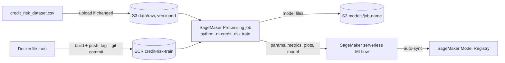

# Credit Ledger: credit risk scoring with SHAP explanations

A FastAPI service and web form that scores consumer loan applications for
default risk with a calibrated XGBoost model. Each score comes with a SHAP
breakdown of the factors behind it.

## Project layout

| Path | Purpose |
|---|---|
| `credit_risk/config.py` | Column lists and allowed category values, shared by training and serving |
| `credit_risk/data.py` | Loading and cleaning the raw CSV |
| `credit_risk/train.py` | Training, calibration, threshold selection, evaluation |
| `credit_risk/model.py` | Model artifact: load/save, predict, SHAP explanations |
| `credit_risk/tracking.py` | MLflow logging and model registration (on when `MLFLOW_TRACKING_URI` is set) |
| `credit_risk/plots.py` | Calibration, precision-recall and SHAP importance plots logged to MLflow |
| `infra/app.py` | AWS CDK stack: S3 bucket, ECR repo, IAM roles, SageMaker serverless MLflow App |
| `scripts/launch_training.py` | Uploads data, builds and pushes the training image, runs the SageMaker job |
| `Dockerfile.train` | Training image (same pinned libraries as the serving image) |
| `main.py` | FastAPI app (`/health`, `/predict`, static frontend) |
| `static/` | Web form |
| `artifacts/` | Trained model, written by `train.py` |
| `tests/` | Model and API tests |
| `Credit_Risk.ipynb` | Original exploration notebook (training now lives in `credit_risk/train.py`) |

## Setup

Python 3.11:

```powershell
py -3.11 -m venv .venv
.\.venv\Scripts\python.exe -m pip install -r requirements-dev.txt
```

## Train

```powershell
.\.venv\Scripts\python.exe -m credit_risk.train --data credit_risk_dataset.csv --out artifacts
```

Takes about 1.5 minutes with the default 60 search trials (`--n-iter`). Writes:

- `preprocessor.joblib`: fitted scikit-learn preprocessing
- `xgb_model.json`: XGBoost booster in its version-stable JSON format
- `model_meta.json`: calibration, thresholds, data hash, best parameters, library versions
- `metrics.json`: test-set metrics, plus a logistic regression baseline

How the training avoids leakage:

1. A stratified 20% test set is held out and only used for the final report.
2. Hyperparameters are tuned with 5-fold CV on the training set (PR-AUC).
3. Platt calibration is fitted on out-of-fold log-odds from the training set.
4. The decision threshold maximises F1 on the calibrated out-of-fold probabilities.
5. The Medium Risk band starts at the training default rate (about 22%).

## Test

```powershell
.\.venv\Scripts\python.exe -m pytest
```

The tests check, among other things, that the SHAP factors add up to the
model's log-odds and that invalid applications return HTTP 422.

## Run locally

```powershell
.\.venv\Scripts\python.exe -m uvicorn main:app --reload
```

Open http://127.0.0.1:8000.

## Docker

```powershell
docker build -t credit-risk:local .
docker run --rm -p 8080:8080 credit-risk:local
```

Open http://127.0.0.1:8080. Set `MODEL_DIR` to load the model from another directory.

## Training on AWS (region ap-south-1)



One-time setup, with AWS credentials for the `dev-aws` profile:

```powershell
$env:AWS_PROFILE = "dev-aws"
cd infra
npx aws-cdk@2 bootstrap      # once per account and region
npx aws-cdk@2 deploy         # S3, ECR, IAM roles, MLflow App
cd ..
```

Train:

```powershell
.\.venv\Scripts\python.exe scripts\launch_training.py --profile dev-aws
```

This uploads the dataset if it changed, builds and pushes the training image,
and runs a SageMaker Processing job on `ml.t3.large` (about 7 minutes, capped at
1 hour by `--max-runtime`). The job logs to the `credit-risk` MLflow experiment
and registers a new version of `credit-risk-xgboost`, which MLflow copies to
the SageMaker Model Registry.

A Processing job is used because new accounts have a quota of 0 for every
training-job instance type. After a quota increase for `ml.m5.large for training
job usage`, run with `--job-type training` to use a Training job instead.

Open the MLflow UI from the SageMaker AI console: **SageMaker AI Studio →
Applications → MLflow → credit-risk-mlflow**.

Remove everything (bucket contents, images and MLflow data included):

```powershell
cd infra; npx aws-cdk@2 destroy
```

## API

`POST /predict`

```json
{
  "person_age": 30,
  "person_income": 60000,
  "person_home_ownership": "RENT",
  "person_emp_length": 5,
  "loan_intent": "PERSONAL",
  "loan_grade": "A",
  "loan_amnt": 10000,
  "loan_int_rate": 7.5,
  "cb_person_default_on_file": "N",
  "cb_person_cred_hist_length": 6
}
```

`loan_percent_income` is computed on the server as `loan_amnt / person_income`.
The response includes the calibrated default probability, the risk band, and
one SHAP factor per input column. `base_value` plus the sum of all
`shap_value`s equals `model_log_odds`.
